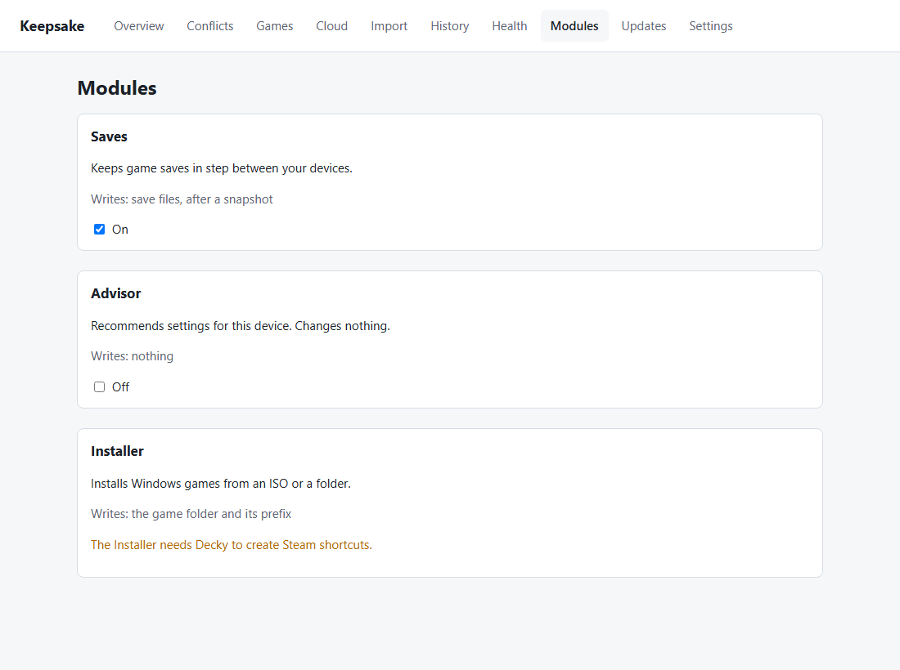

# Advisor

Advisor recommends settings for the game you are playing or have selected, tuned to your device. **It never changes anything.** It shows advice, says where each piece came from and how sure it is, and lets you copy launch options.

It is on by default on a handheld. On a PC it starts switched off, because its advice is built for handhelds. Turn it on under **Modules**.

## What it recommends

- **Power:** the TDP to set, in the terms of the tool you use.
- **Display:** the refresh rate and frame cap, with VRR where your screen has it.
- **Scaling:** the game's own upscaler first, then the gamescope filter. Frame generation (lsfg-vk) only when the base frame rate is high enough.
- **The game's own preset**, plus the Proton version and launch options.

Advisor recognises your device from its hardware (for example the Legion Go and Legion Go 2) and the tools you have installed, such as TDP tools, lsfg-vk and OptiScaler. It only reads them.

## Where its advice comes from

Each source can be switched off, and each is contacted only while it is on:

- **Deck Verified** community reports, from deckverified.games.
- **PCGamingWiki**, using your own PCGamingWiki bot password.
- **ProtonDB** reports, from Keepsake's own monthly index. Games are looked up on your device, so no game is named to anyone.
- **Are We Anti-Cheat Yet**, to warn about games whose anti-cheat blocks Proton.

## Optional AI explanations

If you add your own Anthropic, OpenAI or Google Gemini API key and turn that provider on, Advisor can explain its advice in plain words. A request carries only:
- the game's title;
- your device's hardware profile;
- your tool versions;
- the settings being discussed.

Nothing else is sent, and nothing is sent until you press the button. Without a key, Advisor gives the same advice from its own rules.
