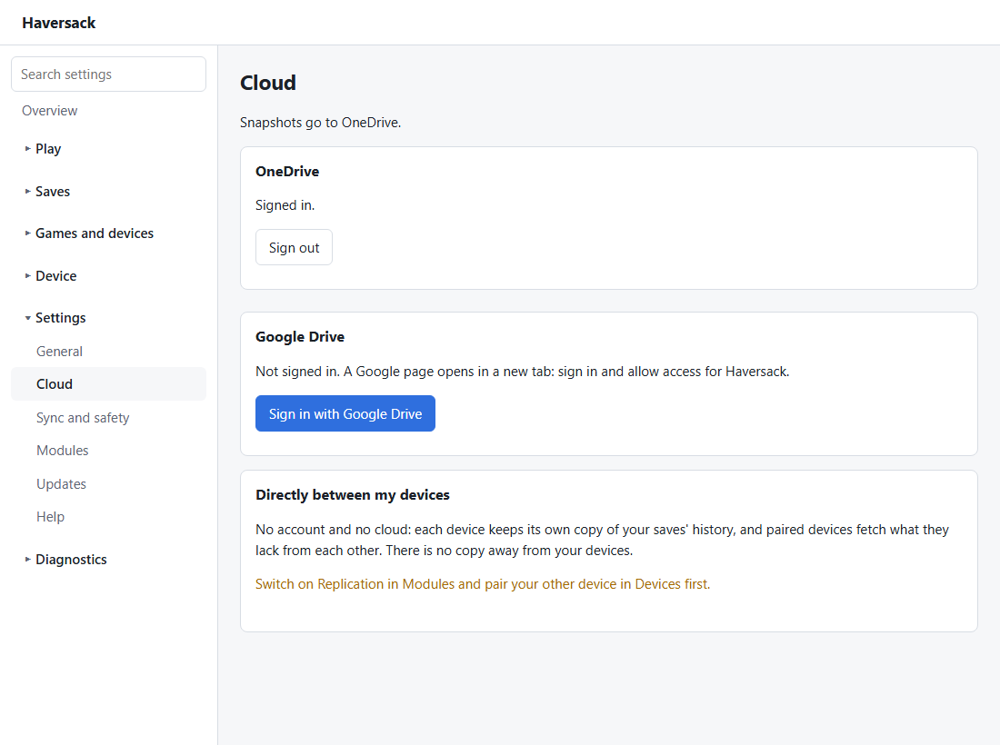

# Cloud storage and sign-in

Haversack stores snapshots in your own cloud storage. There is no Haversack server.

| Service | What Haversack can see |
|---|---|
| OneDrive (personal Microsoft account) | Only the `Apps/Keepsake` folder in your OneDrive, never your other files. It keeps Haversack's former name, so every device, updated or not, uses the same folder. |
| Google Drive | Only Haversack's own hidden app folder, never your files |
| WebDAV, for example Nextcloud | The folder you give it |
| S3 or an S3-compatible service | The bucket and folder you give it |

## Signing in to OneDrive or Google Drive

Choose **Sign in with OneDrive** or **Sign in with Google**. A browser opens the provider's own page. Sign in with your normal account and allow access for Haversack. From then on Haversack keeps itself signed in. You are only asked again if you, or the provider, withdraw its access.

- **On a PC:** your usual browser opens in a new tab.
- **On a handheld in Gaming Mode:** Steam's browser opens where the provider allows it. Google does not allow sign-in inside Steam's browser, so Google shows a code and a QR code instead: scan it with your phone, sign in there and enter the code. A switch lets you choose the browser or your phone for each service. If a browser sign-in does not finish, **Use your phone instead** is one press away.

Check that the page is on `microsoft.com`, `live.com` or `google.com` and names Haversack before you sign in.

Each device signs in for itself. You can sign one device out, at the provider or with **Sign out** in Haversack, without affecting the others.

### Using your own app registration

From version 0.26.0, Haversack includes its own sign-in, so most people never need this. Version 0.25.0 and earlier need your own app registration. Under **Advanced: use my own client ID** you can use your own Microsoft or Google app registration instead of Haversack's: see [setting up Microsoft Entra](../setup-entra.md) and [setting up Google](../setup-google.md).

## WebDAV and S3

Enter the address, user name and password (or access keys) on the Cloud page in Gaming Mode. The server must refuse to overwrite existing files, which Haversack checks before using it. See [WebDAV and S3 set-up](../setup-backends.md).

## Directly between my devices (no cloud account)

If you would rather not use a cloud account, your devices can keep your saves in step with each other directly.

1. Switch on **Replication** in Settings, **Modules**, and pair your devices in **Other devices**. See [Replication](replication.md).
2. On each device, open the Cloud page, choose **Directly between my devices**, and press **Use Directly between my devices for snapshots**.

Each device then keeps its own copy of your saves' history. When your devices can reach each other, each one fetches what it is missing:
- before a game starts;
- when the other device has just saved;
- now and then while Haversack is idle;
- whenever you press **Sync now**.

If the other device is off or away, you play on with the saves this device has, and they meet the next time both are on. If you played on both in between, Haversack shows a conflict and you choose, as with a cloud store.

There is no copy away from your devices. If you lose all of them, the history goes too. A cloud store gives you that off-site copy.

## Choosing where snapshots go

After signing in, choose **Add ... as a save location**. Haversack tests the connection first. Until you add one, snapshots stay in a test store on the device.

You can use several save locations at once, for example OneDrive, directly between your devices, and a NAS over WebDAV. Every snapshot goes to each of them, so you have extra copies:
- If one location cannot be reached, the others still get the snapshot, and that location is caught up later by itself. A location that is down never stops you playing.
- When a game starts, Haversack looks at what all of them hold together.
- The Cloud page lists each location with when it was last reached, how much is still to copy to it, and the space it uses. **Remove** stops using a location; nothing stored there is deleted.
- On a game's page, **Save locations for this game** lets that game use only some of them.
