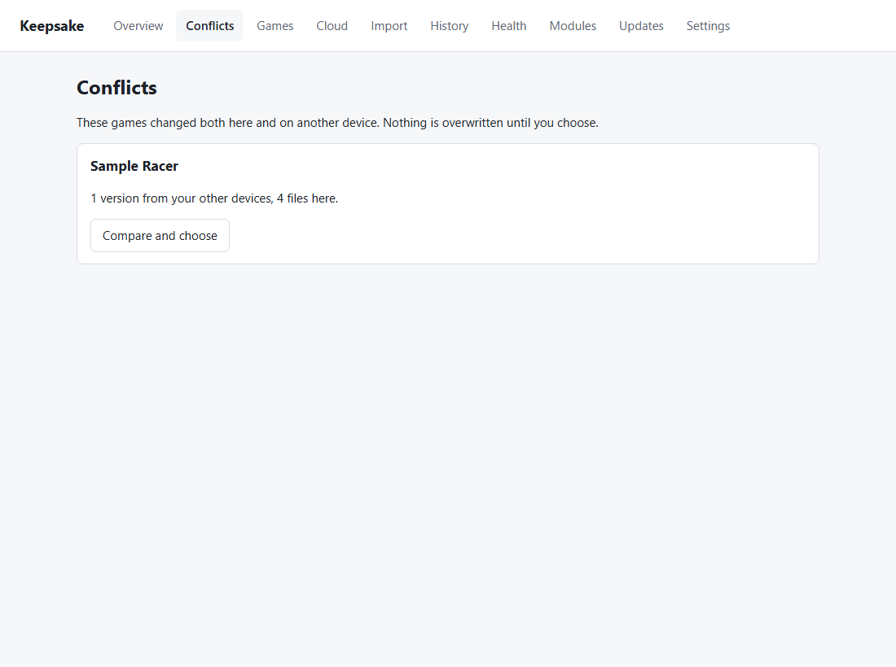
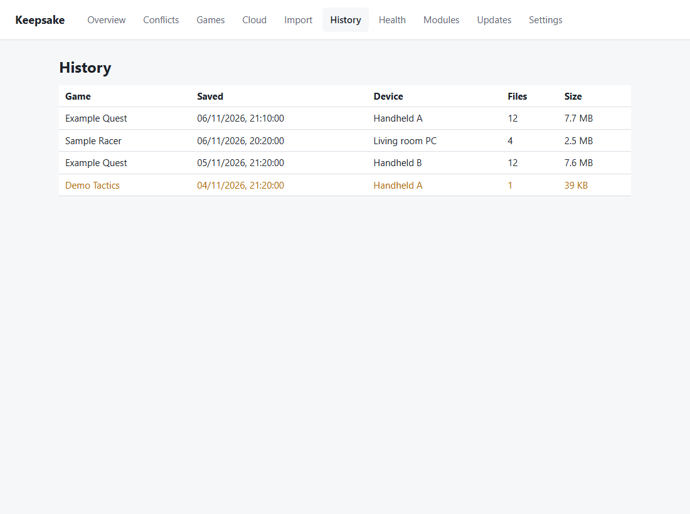

# Conflicts, history and restoring

## Conflicts

A conflict means a game's saves changed on two devices since they last agreed. For example, you played on your handheld on the train while your PC was offline, then played on the PC too. Keepsake cannot know which progress you want, so it asks.

1. Open **Conflicts** and choose **Compare and choose**.
2. Keepsake shows each side: the device, when it was saved, how many files changed and the size.
3. Choose **Keep this device's save** or **Use the save from ...**, then press again to confirm. Or choose **Decide later**.

The save you do not choose is kept in History and pinned, so you can always go back to it. Until you choose, Keepsake does not sync that game, and the game stays playable with the save it has.

## History

Every snapshot of every game is listed in **History**, newest first, with the device it came from.

On a handheld, open a game in **Games** to see its snapshots and:

- **Restore** an older snapshot. Keepsake first takes a snapshot of the current save, so you can undo the restore.
- **Undo restore** to go back to the save you had before.
- **Pin** a snapshot so it is never cleaned up.
- **Release** a held-back snapshot after checking it, so it can be uploaded.

## Clean-up

Keepsake thins out old snapshots over time. It always keeps:
- the last 10 automatic snapshots;
- one a day for 30 days;
- one a month for 12 months.

It never removes:

- a pinned snapshot, including the save you did not choose in a conflict;
- the newest snapshot of each game, and the point each device last synced from;
- anything younger than 7 days;
- snapshots you made by hand, merges, and imported backups.

Only the saved files of an old snapshot are removed. A small record of it stays, so Keepsake can still follow each save's history.
