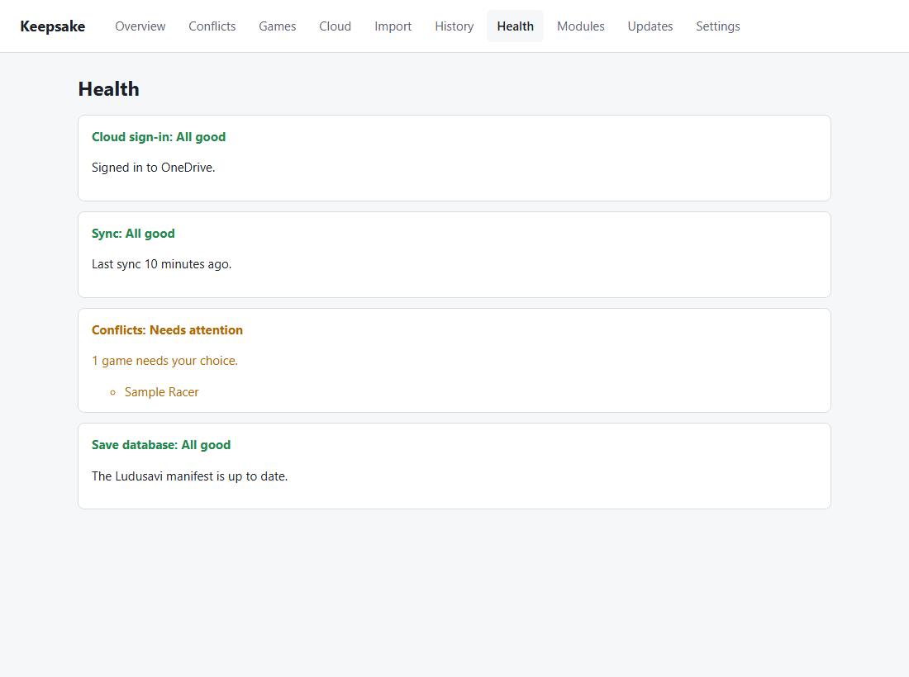

# Questions and answers

**Does Keepsake work with emulators, Heroic, Lutris or Bottles?**
Yes, on a handheld or a Linux PC. See [How syncing works](how-sync-works.md#heroic-lutris-bottles-and-emulators).

**Does Keepsake replace Steam Cloud?**
No, it works beside it. Steam games are listed with your non-Steam games, and their saves are snapshotted, synced, restored and kept in History in exactly the same way. A Steam game you have played that has no Steam Cloud saves starts syncing on its own, and Keepsake tells you when it does. Games that use Steam Cloud stay off unless you turn them on, because Steam already keeps their saves. Turn any game on or off on its page; one you turn off stays off. Settings has **Sync Steam games that Steam Cloud does not back up** to stop the automatic part.

**My non-Steam game has a different shortcut ID on each device. Will it still sync?**
Yes. That is what Keepsake is built for. Saves are stored under neutral locations rather than prefix numbers. The same game is recognised on each device by its save data and title, and by your confirmation when Keepsake is not sure.

**What happens if I play on two devices without syncing in between?**
Keepsake notices that both changed and asks you which save to keep. The other one stays in History, pinned. See [Conflicts, history and restoring](conflicts-and-history.md).

**Can a sync ever wipe my save?**
Keepsake takes and checks a snapshot of your current save before replacing any file, so every restore can be undone. A save that suddenly loses most of its files is held back on the device instead of being uploaded.

**What if I am offline?**
Games always start. Keepsake syncs the next time it can reach your cloud.

**Why does my game pause for a moment when it starts?**
On a handheld, Keepsake pauses the game briefly while it checks for a newer save, so it can put that save in place before the game reads it. A watchdog always resumes the game, whatever happens. You can switch this off per game.

**Why does a PC not pause the game?**
On a PC, Keepsake does not start your games, so it cannot pause one safely at launch. It never touches saves while a game runs. Press **Sync now** before playing to be sure you have the newest save.

**Does Keepsake need root, Desktop Mode or a terminal?**
No. On a handheld everything happens in Gaming Mode with the controller. Nothing runs as root, and Keepsake installs no extra programs.

**Is my health page showing a warning?**

Each check says what is wrong and what to do. Most warnings are a game waiting for your choice in Conflicts, or a sign-in that needs renewing. See [Troubleshooting](../troubleshooting.md).

**Can I leave Keepsake and keep my saves?**
Yes. Settings, **Export snapshots** copies them out as plain zip files with a list of their contents. See [Conflicts, history and restoring](conflicts-and-history.md#exporting-your-saves).

**Where do I report a problem?**
Open an issue on [GitHub](https://github.com/breakmylegs/keepsake/issues). For a security problem, use **Report a vulnerability** on the repository's Security tab instead, so it stays private. Diagnostics, then **Export diagnostics**, makes a file you can attach. Tokens and passwords are removed from it, but read it first.

**Why does my library show my other handheld's games with Stream instead of Play?**
That is Steam Remote Play. When your other device is on with Steam running, Steam lists the games installed there in this device's library, so you can stream them. A non-Steam game installed on the other device shows as a tile with **Stream**. If you have the same game on both, you may see it twice. Keepsake never treats these as games on this device: they are left out of the Games list, save sync, Send to, Replication, Advisor and Uninstall. Keepsake's Games page says how many there are, and **Show games you can stream from another device** lists them.

To see only the games installed on this device, use the **Installed** tab in Steam's library, or switch off Remote Play in Steam's settings. Keepsake does not hide them for you yet: Steam may share hidden games between your devices, so hiding one here could hide the real game on your other handheld. If a game on this device ever becomes hidden, Keepsake tells you and offers **Show it again**.
