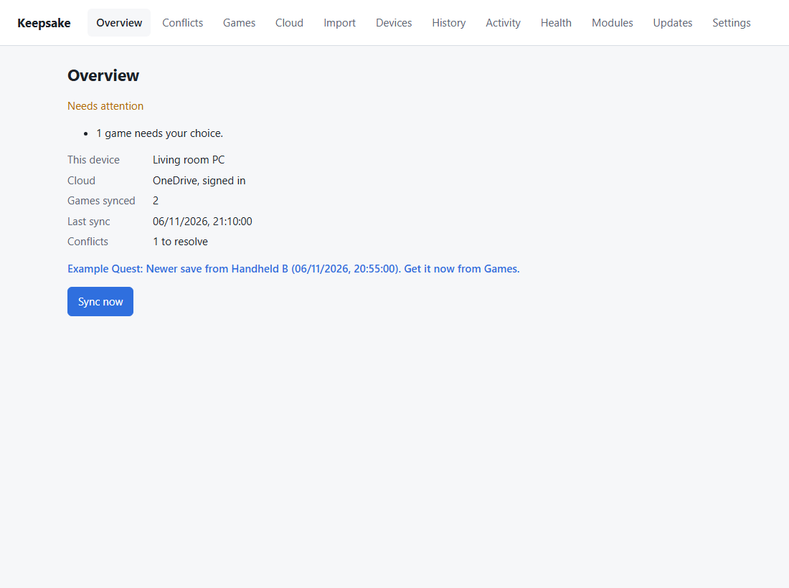
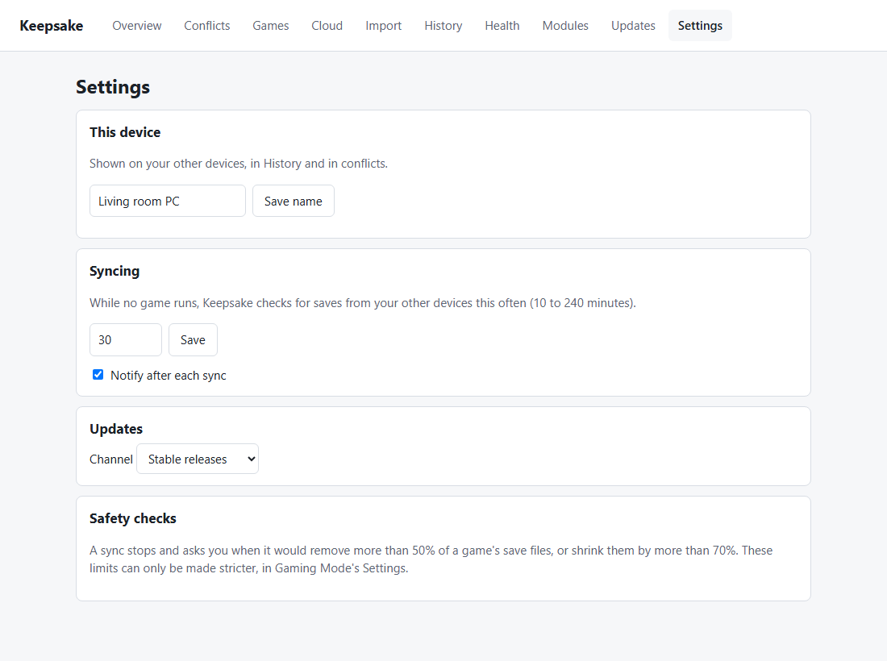

# Getting started on a Linux PC

Haversack runs on Linux desktops and laptops. With Decky Loader in Steam's Big Picture mode, follow [the handheld guide](getting-started-handheld.md) instead. Without Decky, Haversack runs as a small background program with a page in your browser, as described here.

The PC version is a preview: the main screens are in place, and more follow.

## 1. Install

1. You need Python 3.11 or newer. Most distributions already have it as `python3`.
2. Download `Haversack-desktop-v<version>.zip` from the [latest release](https://github.com/breakmylegs/haversack/releases/latest) and unzip it anywhere.
3. In that folder, run:
   ```
   python3 install.pyw
   ```

Haversack installs into `~/.local/share/keepsake/app`, adds itself to your app menu, starts when you sign in, and opens in your browser. It needs no administrator rights. The download is covered by the release's signature, which Haversack also checks on every update.

- To install without starting at sign-in, add `--no-autostart`.
- To remove Haversack, run `python3 install.pyw --uninstall`. Your settings and saves are kept.

## 2. Set it up



1. Open **Cloud** and sign in ([Cloud storage and sign-in](cloud.md)). Then choose **Use ... for snapshots**.
2. Open **Games** and turn on **Sync this game** for each game you want ([How syncing works](how-sync-works.md)).
3. In **Settings**, give this computer a name your other devices will show.



## What is different on a PC

- Haversack does not pause a game when it starts. Instead, it never restores a save while a game is running, and saves to the cloud a few seconds after you quit. Saves from your other devices arrive when Haversack syncs while the game is closed.
- The Installer needs Decky, so it is not available on a PC. Advisor starts switched off, because its advice is built for handhelds.

Haversack keeps its settings in `~/.config/keepsake` and its state and logs in `~/.local/state/keepsake`.
