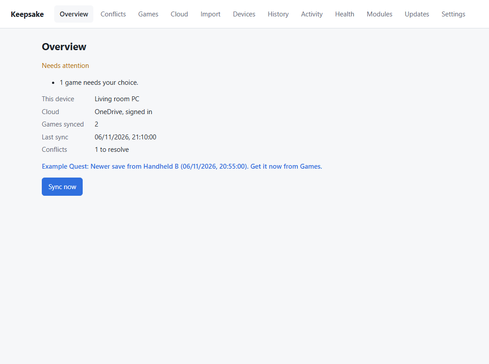

# Getting started on Windows

Keepsake runs on Windows 10 and 11 as a small background program with a page in your browser. It finds Steam for Windows, its libraries and your non-Steam shortcuts. It reads your games' saves from your Windows folders. The same game's saves from a handheld's Proton prefix count as the same files, so they sync between the two.

The PC version is a preview: the main screens are in place, and more follow.

## 1. Install

1. Install Python 3.11 or newer, for example with:
   ```
   winget install Python.Python.3.13
   ```
2. Download `Keepsake-desktop-v<version>.zip` from the [latest release](https://github.com/breakmylegs/haversack/releases/latest) and unzip it anywhere.
3. Double-click `install.pyw` in that folder.

Keepsake installs into `%LOCALAPPDATA%\Keepsake\app`, starts when you sign in to Windows, and opens in your browser. It needs no administrator rights. To open it later, run `keepsake.pyw` in that folder. The download is covered by the release's signature, which Keepsake also checks on every update.

- To install without starting at sign-in, run `python install.pyw --no-autostart`.
- To remove Keepsake, run `python install.pyw --uninstall`. Your settings and saves are kept.

## 2. Set it up



1. Open **Cloud** and choose **Sign in with OneDrive** or **Sign in with Google**. Your browser opens the provider's page: sign in and allow access ([Cloud storage and sign-in](cloud.md)).
2. Open **Games** and turn on **Sync this game** for each game you want.
3. In **Settings**, give this computer a name your other devices will show.

## What is different on a PC

- Keepsake never restores a save while a game is running, and saves to the cloud a few seconds after you quit ([How syncing works](how-sync-works.md)).
- The Installer needs Decky, so it is not available on Windows. Advisor starts switched off.

Keepsake keeps its settings in `%APPDATA%\Keepsake` and its state and logs in `%LOCALAPPDATA%\Keepsake`.
