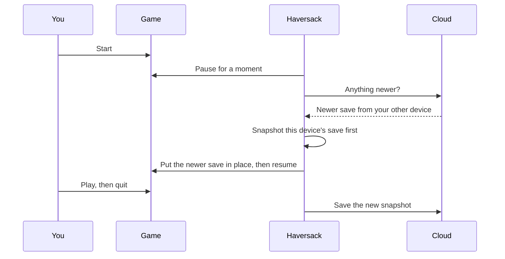
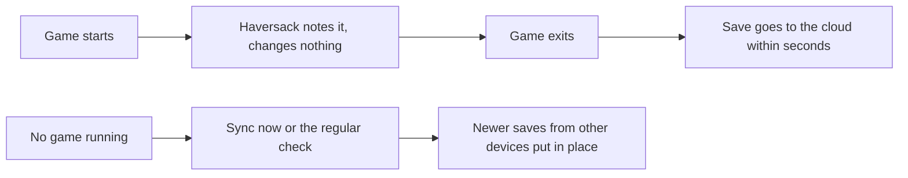
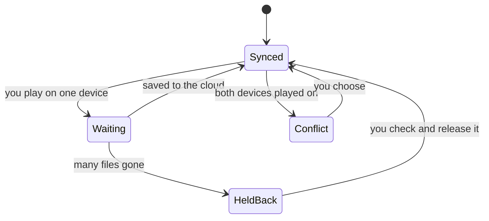

# How syncing works

Haversack works with snapshots. Each time a game's saves change, Haversack records a snapshot: a copy of that game's save files, identified by their content. Snapshots go to your cloud storage and are never changed afterwards. Each snapshot remembers which one it came from, so Haversack always knows whether two devices played on from the same point.

## Choosing games

Turn on **Sync this game** for each game whose saves should follow you. Haversack works out where each game keeps its saves from the [Ludusavi manifest](https://github.com/mtkennerly/ludusavi-manifest), a community list of save locations. If a game matches more than one entry, or none, pick its save data from the list or search for it.

When another device has already linked a game, Haversack asks whether this is **Same game** or **A different game**. Your answer links the two, even if the shortcuts have different names.

## On a handheld

- **Before a game starts:** Haversack pauses it for a moment, checks the cloud, and puts a newer save in place if there is one. A watchdog always resumes a paused game, whatever happens. If the check takes too long or the network is down, the game simply starts with the save it has.
- **After you quit:** the new save goes to the cloud.
- **While no game runs:** Haversack checks for saves from your other devices every 30 minutes (change it in Settings), and when you press **Sync now**.

## On a PC

A PC cannot pause a game the way Steam on a handheld lets Haversack do, so Haversack never touches a game's saves while it runs.

## Heroic, Lutris, Bottles and emulators

On a handheld or a Linux PC, **Games** also lists your Heroic (GOG and Epic), Lutris and Bottles games, and one entry for each emulator whose saves Haversack knows: RetroArch, Dolphin, PCSX2, DuckStation, PPSSPP, RPCS3 and Cemu. Use the filters **Heroic, Lutris, Bottles** and **Emulators** to find them, then turn sync on like any other game.

- Haversack cannot see these games start, so it saves after you play and brings in newer saves from your other devices in the background. It only does so while the game or emulator is closed, and only when you have not played on since. Otherwise it asks you.
- Emulator entries sync battery and memory-card saves. **Include save states** on the game page adds save states too. They are off by default, because a save state often does not load in another version of the emulator.
- Heroic can sync GOG and Epic saves itself. Use either Heroic's sync or Haversack's for a game, not both.
- **Settings, Show other launchers** turns these entries off.

## Newer save from another device

When another device has saved a game since this one last synced it, the game's row, the Quick Access Menu and the PC Overview say so: "Newer save from Handheld B, 10 minutes ago". On a handheld it is brought in automatically when you start the game. **Get it now** on the game's row brings it in straight away, on a handheld or a PC. It only does so when you have not played on since; otherwise it tells you there is a conflict, and nothing is replaced.

## Playtime

Each game's page shows how long you have played it across your devices, for example "Played 12 h 30 min on your devices", with the time on each one. Sessions under a minute and over a day are not counted. Playtime is shown for your information only, and never decides which save is kept.

## A game's launch options

A game's page in **Saves**, **Games** has **Launch options**, with switches for Proton's own settings:
- **Write a Proton log** (`PROTON_LOG=1`), saved as `steam-<app>.log` in your home folder;
- **Use WineD3D instead of DXVK**, for graphics problems;
- **Turn off fsync**, and **Turn off esync** on Proton before version 11, for games that hang;
- **Short OpenGL extension list**, for old games that crash at start.

Haversack keeps the rest of the launch options exactly as they were, and changes them only through Steam when you press a switch. The first time, it keeps a copy of the options as they were, so **Put back original** restores them exactly. A game that uses the strict launch gate keeps its launch options for the gate: turn the gate off first.

## What Haversack will never do

- **Overwrite a save without asking.** When both devices have new progress, you choose ([Conflicts, history and restoring](conflicts-and-history.md)).
- **Lose the save it replaces.** Before any save file is replaced, a snapshot of the current one is taken and checked, so every restore can be undone.
- **Let timestamps pick a winner.** Clocks on different devices disagree. Haversack compares content and history, and shows times only for your information.
- **Upload a save that looks broken.** If a sync would remove more than half of a game's save files, or shrink them by more than 70 percent, Haversack keeps that snapshot on the device, marks it as held back, and asks you.

