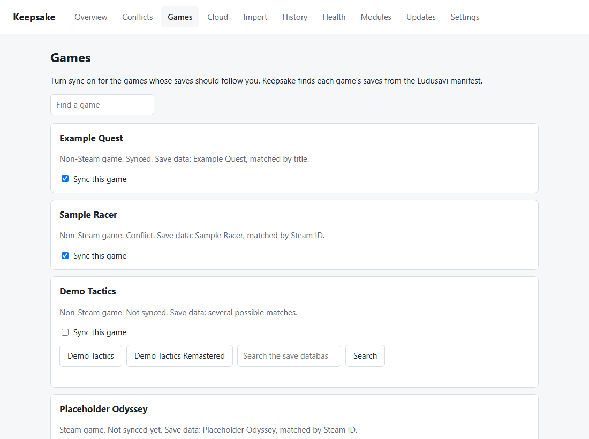
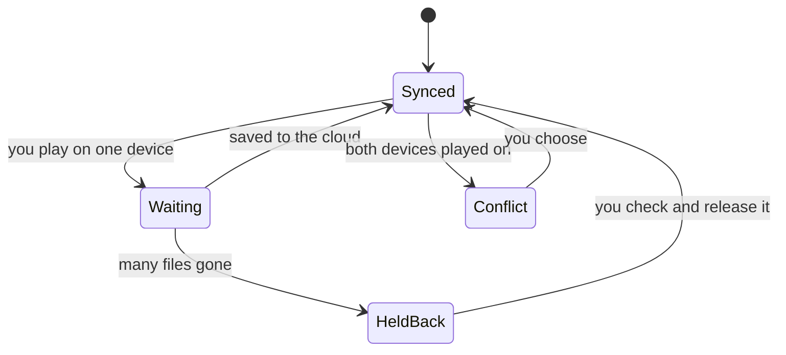

# How syncing works

Keepsake works with snapshots. Each time a game's saves change, Keepsake records a snapshot: a copy of that game's save files, identified by their content. Snapshots go to your cloud storage and are never changed afterwards. Each snapshot remembers which one it came from, so Keepsake always knows whether two devices played on from the same point.

## Choosing games

Turn on **Sync this game** for each game whose saves should follow you. Keepsake works out where each game keeps its saves from the [Ludusavi manifest](https://github.com/mtkennerly/ludusavi-manifest), a community list of save locations. If a game matches more than one entry, or none, pick its save data from the list or search for it.

When another device has already linked a game, Keepsake asks whether this is **Same game** or **A different game**. Your answer links the two, even if the shortcuts have different names.

## On a handheld

- **Before a game starts:** Keepsake pauses it for a moment, checks the cloud, and puts a newer save in place if there is one. A watchdog always resumes a paused game, whatever happens. If the check takes too long or the network is down, the game simply starts with the save it has.
- **After you quit:** the new save goes to the cloud.
- **While no game runs:** Keepsake checks for saves from your other devices every 30 minutes (change it in Settings), and when you press **Sync now**.

## On a PC

A PC cannot pause a game the way Steam on a handheld lets Keepsake do, so Keepsake never touches a game's saves while it runs. Saves from your other devices arrive when Keepsake syncs while the game is closed. Press **Sync now** on the Overview before you play, to be sure you have the newest save.

## What Keepsake will never do

- **Overwrite a save without asking.** When both devices have new progress, you choose ([Conflicts, history and restoring](conflicts-and-history.md)).
- **Lose the save it replaces.** Before any save file is replaced, a snapshot of the current one is taken and checked, so every restore can be undone.
- **Let timestamps pick a winner.** Clocks on different devices disagree. Keepsake compares content and history, and shows times only for your information.
- **Upload a save that looks broken.** If a sync would remove more than half of a game's save files, or shrink them by more than 70 percent, Keepsake keeps that snapshot on the device, marks it as held back, and asks you.

