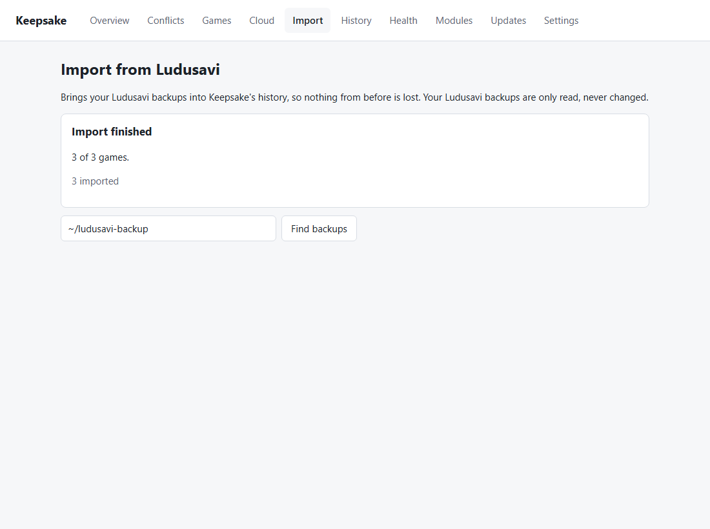

# Importing from Ludusavi

If you used [Ludusavi](https://github.com/mtkennerly/ludusavi) before, Keepsake can bring its backups into Keepsake's history, so nothing from before is lost. Your Ludusavi backups are only read, never changed.

1. Open **Import saves** (handheld) or **Import** (PC).
2. Enter the folder of your Ludusavi backups (`~/ludusavi-backup` by default) and choose **Find backups**.
3. Keepsake lists each game with the number of backups it found.
4. Choose **Import the latest backup of each game**, or **Import every backup** to bring the whole history.

The import runs in the background with progress, and **Stop importing** stops it between games. Importing the same backup twice does nothing the second time.

Imported snapshots appear in History like any other. They do not change the saves on your device: Keepsake treats them as history to restore from when you want.

Moving over from a Ludusavi and rclone setup on two handhelds? The step-by-step plan is in [the cutover guide](../cutover.md).
