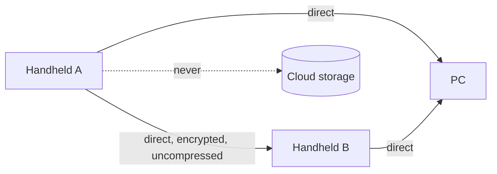

# Replication: your devices

Replication links your own devices directly: handhelds, Linux PCs and Windows PCs. It pairs them, then sends non-Steam games between them: a game you set up on one handheld appears on the other, playable, with the same Proton version, artwork and launch options.

## Switch it on

1. Open Keepsake, then **Settings**, then **Modules**, and switch on **Replication**. **Games and devices** then has **Moving games** and **Other devices**. On a PC, it is the **Moving games and devices** page.
2. On **Other devices**, switch on **Let other devices reach this one**. Until you do, nothing on your network can connect to this device.

Do this on each device you want to link. You need no SSH, keys or accounts.

## Pair two devices

1. On the other device, switch on **Let other devices reach this one** under Other devices.
2. On the device you are holding, press **Find devices**, choose the other one and press **Pair**. If it is not listed, for example over a VPN, type its address under **Pair by address**.
3. The other device shows "*name* wants to pair", with the address it came from. Press **Accept** if it is your own device; **Decline** if you do not recognise it. If a game is running there, you get a notification instead, and the request waits under Other devices.
4. It then shows a 6-digit code. Type that code on the first device with the number pad and press **OK**.
5. Both show **Paired**. If the code was wrong, both say so and nothing is paired; start again.

Pairing is trust both ways. When it finishes, the device you started from can be reached too, so games can go in either direction. "Let other devices reach this one" switches that off again.

The code is new each time and only works for that attempt. A device that keeps getting it wrong, or keeps asking, is locked out for ten minutes.

Each device you pair is linked to every other one you pair, so a group such as two handhelds and a PC works.

## Paired devices

- **Check** connects and shows the round trip. Over a VPN it says when the link looks slow, which can mean the VPN is relaying it.
- **Wake** sends a Wake-on-LAN signal. It usually wakes a PC on a cable. A handheld asleep on Wi-Fi usually cannot be woken this way.
- **Remove** forgets a device. It can no longer connect until you pair it again.

## Send a game

1. On the device that has the game, open it in **Saves**, **Games** and press **Send to <device>**.
   - Keepsake first asks the other device whether the game fits, and stops at once if it does not, for example "Legion Go 2 doesn't have enough space: needs 41.2 GiB, has 12.0 GiB free".
   - It then checks every file, which takes a few minutes for a large game.
   - If Saves syncs the game, the newest saves go first.
2. The other device starts copying by itself, with a toast. There is nothing to accept.
   - If that device lacks the game's compatibility tool (a GE-Proton version, for example), Keepsake copies it too. Steam finds a copied tool after a restart.
   - Launch options that only make sense on the first device, such as a mounted disc, stay behind, and Keepsake lists them.
3. Keepsake copies the game, adds it to Steam with the same name, program, launch options, Proton version and artwork, and says when it is ready. If Saves synced the game, it carries on with the same saves, with no conflict.

## Get a game from another device

1. On **Other devices**, press **Games on <device>**. Its non-Steam games are listed.
2. Choose one and press **Get this game**. Keepsake checks there is room on this device first.
3. The other device sends it as if you had pressed Send there, and shows a toast that the game is being copied from it. The same rules apply: nothing here is replaced, a missing compatibility tool is copied, and the game is added to Steam.

## Watch it move

Every game on its way, in either direction, has a bar on both devices:
- under **Moving games**;
- as a short line in the quick access menu;
- in the desktop app's table.

Each bar shows the percentage done, GiB done of the total, the speed, the time left and the stage:
- Checking space;
- Preparing;
- Copying;
- Verifying;
- Adding to Steam;
- Done, or Failed with the reason.

Several games each get their own bar. The bars carry on if you close Keepsake and open it again.

**Stop and remove** works on either device and asks you first:
- **On the receiving device** it deletes everything that copy made there: its folder, its prefix, a copied tool and its Steam shortcut. Nothing else is touched.
- **On the sending device** it asks the receiving device to do the same, and then stops offering the game.

**Clear** tidies a finished or failed bar away. A finished game stays. A failed copy is removed, as Stop and remove does.

## Keep a game in step

Once a game has been sent, each device knows the other has it. When it changes on one device, for example after a patch or a mod, Keepsake notices when you quit the game.

- On the game's page in Keepsake, **Updates** sets what happens:
  - **Ask me** (the default) shows **Send update**;
  - **Take them by themselves** sends and applies updates without asking;
  - **Off** stops keeping it in step.
- **Check now** looks for changes straight away. A big game takes a while.
- On the other device, the update appears under **Moving games**. **Apply update** takes it, and **Keep mine** leaves that device's copy as it is.
- If the game changed on both devices, Keepsake changes nothing and asks you. **Take theirs** replaces this device's copy with the other's, and **Keep mine** keeps it.
- **Stop update** stops an update part way. The game stays exactly as it was.

Your saves and settings on each device are never replaced by an update, whichever you choose. Saves looks after them.

## Firewalls

Keepsake never changes your firewall. **Diagnostics**, **Health** says what to allow, if anything: TCP 47110 and UDP 5353.
- On Windows, allow Python on private networks when Windows asks.
- On Bazzite, the default settings already allow it.

## Promises

- **Device to device only.** Game files go straight between your own devices, on your home network or over your own VPN (WireGuard, Tailscale or ZeroTier). They never go through cloud storage, or through any server or relay run by Keepsake.
- **Paired devices only.** Every connection is encrypted with a key only your two devices know. Devices you have not paired are refused.
- **Exact copies.** Files arrive exactly as they were, with their sizes, permissions, times and links. Nothing is compressed, at any layer.
- **Pause and resume.** You can pause a transfer and resume it later. It also carries on by itself after errors, a lost network, the other device going away and coming back, a restart, sleep, or a power cut. Nothing already checked is sent twice.
- **Stop means clean.** **Stop and remove**, which asks you first, deletes everything the transfer made: partial files, the shortcut, the prefix and any tool copy. Your existing install is never touched.
- **Room to spare.** Keepsake checks there is enough free space before anything is read or copied, and keeps the device awake while it copies.
- **Honest speed.** Both devices show the speed, time left and progress, and say plainly when a link looks slow.
- **Saves stay with Saves.** Replication never touches save files. Keepsake's save sync looks after them.

## Emulators

**Games and devices**, **Emulators** shows what this device has:
- EmuDeck or RetroDECK, and the standalone emulators;
- every emulator game, with multi-disc games grouped as one;
- how many firmware, BIOS and key files there are.

Keepsake only counts the firmware, BIOS and key files and never reads them.

**Send to** your other handheld (one button per game) copies:
- the game's files, with multi-disc games kept together;
- the emulator and its settings, but only if the other handheld lacks them;
- firmware and keys, only when you tick **Also send firmware and keys**. They go only straight to your own paired handheld, over the encrypted link, and are stored there for your user only. Never to the cloud. Copy only what you own.

Accept it on the other handheld, as with any game. Nothing already there is replaced. The game gets a Steam shortcut made from that handheld's Steam ROM Manager setup; if it has none, add the shortcut with Steam ROM Manager. Flatpak emulators are not copied: install them on the other handheld first.
