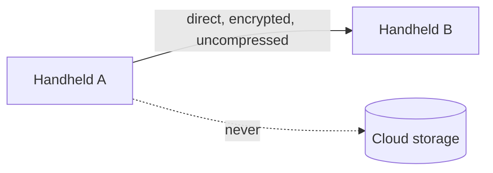

# Replication (in development)

Replication will send a whole game from one of your devices to another: a non-Steam game you set up on one handheld appears on the other, playable, with the same Proton version, artwork and launch options. It is not available yet. This page says how it will work, so you know what to expect.

## Promises

- **Device to device only.** Game files go straight between your own devices, on your home network or over your own VPN (WireGuard, Tailscale or ZeroTier). They never go through cloud storage, or through any server or relay run by Keepsake.
- **Exact copies.** Files arrive exactly as they were, with their sizes, permissions, times and links. Nothing is compressed, at any layer.
- **Pause and resume.** You can pause a transfer and resume it later. It also carries on by itself after errors, a lost network, the other device going away and coming back, a restart, sleep, or a power cut. Nothing already checked is sent twice.
- **Stop means clean.** **Stop and remove**, which asks you first, deletes everything the transfer made: partial files, the shortcut, the prefix and any tool copy. Your existing install is never touched.
- **Room to spare.** Keepsake checks there is enough free space before it starts, and keeps the device awake while it copies.
- **Honest speed.** It shows the speed, time left and progress for each file. It says plainly when a link looks slow, for example when a VPN relays it.
- **Off until you turn it on.** Nothing listens on your network until you switch Replication on and pair your devices with a short code.
- **Saves stay with Saves.** Replication never touches save files. Keepsake's save sync looks after them.
