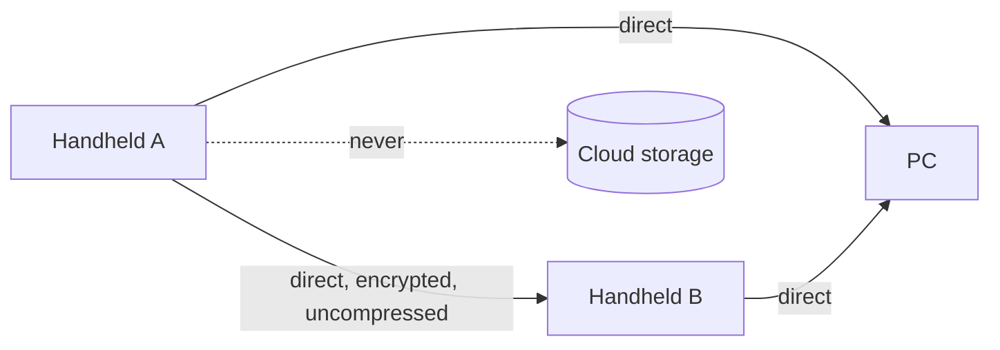

# Replication: your devices

Replication links your own devices directly: handhelds, Linux PCs and Windows PCs. It pairs them, then sends non-Steam games between them: a game you set up on one handheld appears on the other, playable, with the same Proton version, artwork and launch options.

## Switch it on

1. Open Keepsake, then Settings, then **Modules**, and switch on **Replication**. A **Devices** tab appears. On a PC, it is the **Devices** page.
2. On **Devices**, switch on **Let other devices reach this one**. Until you do, nothing on your network can connect to this device.

Do this on each device you want to link. You need no SSH, keys or accounts.

## Pair two devices

1. On both devices, switch on **Let other devices reach this one** under Devices.
2. On the device you are holding, press **Find devices**, choose the other one and press **Pair**. If it is not listed, for example over a VPN, type its address under **Pair by address**.
3. The other device shows "*name* wants to pair", with the address it came from. Press **Accept** if it is your own device; **Decline** if you do not recognise it. If a game is running there, you get a notification instead, and the request waits under Devices.
4. It then shows a 6-digit code. Type that code on the first device with the number pad and press **OK**.
5. Both show **Paired**. If the code was wrong, both say so and nothing is paired; start again.

The code is new each time and only works for that attempt. A device that keeps getting it wrong, or keeps asking, is locked out for ten minutes.

Each device you pair is linked to every other one you pair, so a group such as two handhelds and a PC works.

## Paired devices

- **Check** connects and shows the round trip. Over a VPN it says when the link looks slow, which can mean the VPN is relaying it.
- **Wake** sends a Wake-on-LAN signal. It usually wakes a PC on a cable. A handheld asleep on Wi-Fi usually cannot be woken this way.
- **Remove** forgets a device. It can no longer connect until you pair it again.

## Send a game

1. On the device that has the game, open it in Keepsake's **Games** and press **Send to <device>**. Keepsake checks every file first, which takes a few minutes for a large game. If Saves syncs the game, the newest saves go first.
2. On the other device, open **Devices**. Under **Games between devices**, press **Accept**.
   - If that device lacks the game's compatibility tool (a GE-Proton version, for example), Keepsake offers to copy it too. Steam finds a copied tool after a restart.
   - Launch options that only make sense on the first device, such as a mounted disc, stay behind, and Keepsake lists them.
3. Keepsake copies the game, adds it to Steam with the same name, program, launch options, Proton version and artwork, and says when it is ready. If Saves synced the game, it carries on with the same saves, with no conflict.
4. **Clear from this list** tidies a finished game away. The game stays.

**Stop and remove** on a game being received deletes everything that copy made on this device: its folder, its prefix, a copied tool and its Steam shortcut. Nothing else is touched.

On the sending device, **Withdraw** an offer once the game has arrived, to free the space Keepsake keeps for it.

## Keep a game in step

Once a game has been sent, each device knows the other has it. When it changes on one device, for example after a patch or a mod, Keepsake notices when you quit the game.

- On the game's page in Keepsake, **Updates** sets what happens:
  - **Ask me** (the default) shows **Send update**;
  - **Take them by themselves** sends and applies updates without asking;
  - **Off** stops keeping it in step.
- **Check now** looks for changes straight away. A big game takes a while.
- On the other device, the update appears in **Devices**. **Apply update** takes it, and **Keep mine** leaves that device's copy as it is.
- If the game changed on both devices, Keepsake changes nothing and asks you. **Take theirs** replaces this device's copy with the other's, and **Keep mine** keeps it.
- **Stop update** stops an update part way. The game stays exactly as it was.

Your saves and settings on each device are never replaced by an update, whichever you choose. Saves looks after them.

## Firewalls

Keepsake never changes your firewall. Settings, **Health** says what to allow, if anything: TCP 47110 and UDP 5353.
- On Windows, allow Python on private networks when Windows asks.
- On Bazzite, the default settings already allow it.

## Promises

- **Device to device only.** Game files go straight between your own devices, on your home network or over your own VPN (WireGuard, Tailscale or ZeroTier). They never go through cloud storage, or through any server or relay run by Keepsake.
- **Paired devices only.** Every connection is encrypted with a key only your two devices know. Devices you have not paired are refused.
- **Exact copies.** Files arrive exactly as they were, with their sizes, permissions, times and links. Nothing is compressed, at any layer.
- **Pause and resume.** You can pause a transfer and resume it later. It also carries on by itself after errors, a lost network, the other device going away and coming back, a restart, sleep, or a power cut. Nothing already checked is sent twice.
- **Stop means clean.** **Stop and remove**, which asks you first, deletes everything the transfer made: partial files, the shortcut, the prefix and any tool copy. Your existing install is never touched.
- **Room to spare.** Keepsake checks there is enough free space before it starts, and keeps the device awake while it copies.
- **Honest speed.** It shows the speed, time left and progress for each file, and says plainly when a link looks slow.
- **Saves stay with Saves.** Replication never touches save files. Keepsake's save sync looks after them.
