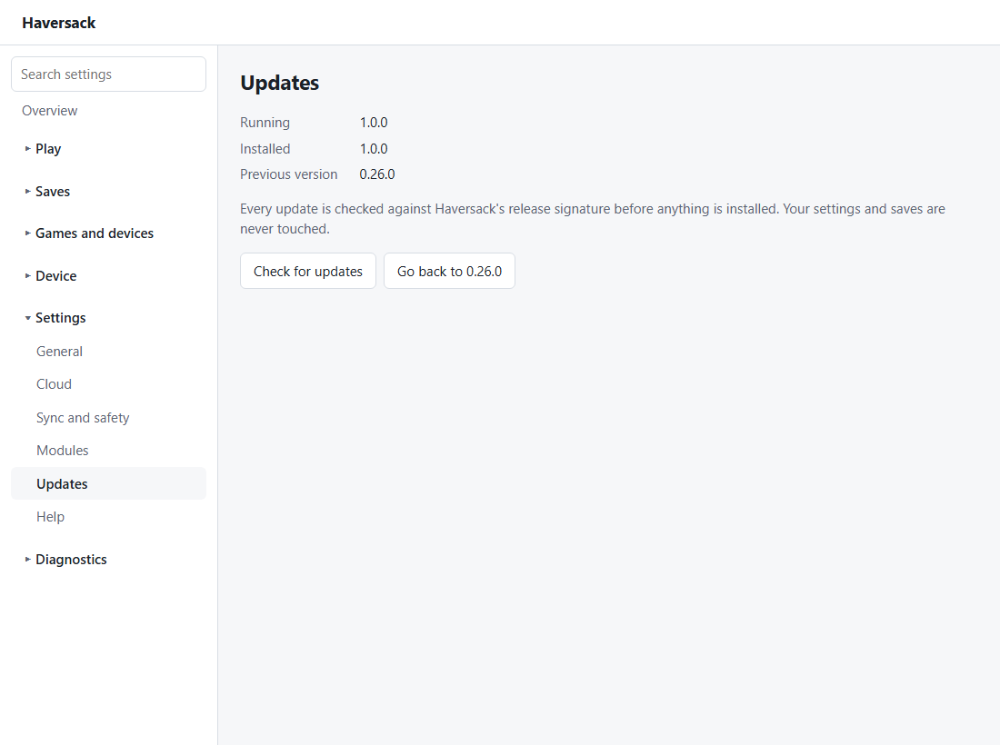

# Updates

Every Haversack release is signed, and lists every third-party component it contains in a software bill of materials. Before installing an update, Haversack checks the signature against Haversack's own key, which is built in, and checks the download against the signed list of checksums. An update that fails either check is refused.

## On a handheld

Open **Settings**, **Updates** in Haversack. When a new version is available, the Quick Access Menu also says so. Choose the version and install it: Haversack hands the checked download to Decky's own installer. You can also go back to an earlier version from the same page.

The **Channel** setting chooses between stable releases only, or test releases too.

After an update, Haversack shows **What's new** once, from that version's release notes.

## On a PC

1. Open **Updates** and choose **Check for updates**.
2. Choose **Install** for the new version. It is installed beside the one you are running.
3. Choose **Restart Haversack now**. Haversack opens again in a new tab, on the new version.

The version you had is kept. **Go back to ...**, then a restart, returns to it.

Updates never change your settings, your saves or whether Haversack starts when you sign in.

## Keepsake is now Haversack

Version 0.51.0 renamed Keepsake to Haversack. On a handheld, update Keepsake as usual. Decky installs Haversack beside Keepsake, at the top of its list:

1. Open Haversack in the Quick Access Menu. It shows one card, "Keepsake is now called Haversack". Until you go on, Keepsake keeps working and Haversack does nothing, so the two never sync at once.
2. Press **Remove the old Keepsake** and confirm. Haversack removes Keepsake (and Keepsake Helper, if you had it), copies your settings, sign-ins, games and history across, checks every file, and starts.
3. If you use the helper, install Haversack Helper from **Device**, **Controllers**, **Reconnect help**.

Nothing is lost:
- Your old copy stays on the device.
- Your cloud folder keeps its name, so your other devices carry on before they update.
- Microsoft's and Google's sign-in pages still show the registered name, Keepsake.

To go back, remove Haversack in Decky's settings and install an earlier Keepsake from the Releases page. If you later update again, Haversack brings in what Keepsake did meanwhile, and keeps its own earlier copy aside.

On a PC, the update installs Haversack in place of Keepsake, in the same folders.
